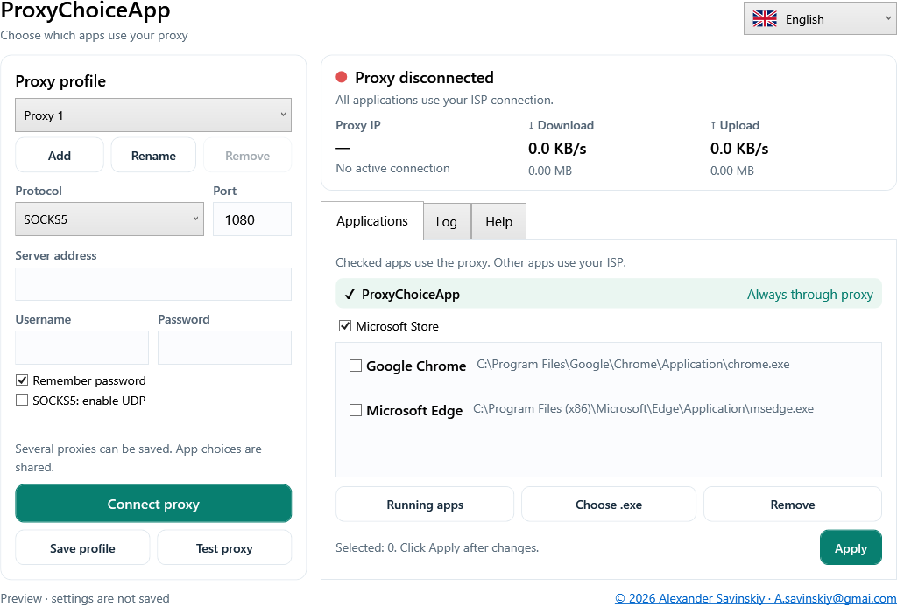

# ProxyChoiceApp

A compact Windows application that sends **selected applications through a proxy** and leaves other applications on their ordinary ISP connection.

**Author:** Alexander Savinskiy · [A.savinskiy@gmai.com](mailto:A.savinskiy@gmai.com)
**Windows:** 10/11 x64 · **License:** GPL-3.0-or-later

[Русский](docs/README-ru.md) · [Deutsch](docs/README-de.md) · [Español](docs/README-es.md)
[Detailed English guide](docs/Guide-en.md) · [Русское руководство](docs/Guide-ru.md) · [Deutsches Handbuch](docs/Guide-de.md) · [Guía en español](docs/Guide-es.md)



## Download and use

The [Releases page](https://github.com/alexander-savinskiy/ProxyChoiceApp/releases) provides:

- **ProxyChoiceApp-Setup.exe** — self-extracting installer, shortcuts and uninstaller.
- **ProxyChoiceApp.exe** — standalone executable; no separate .NET installation.
- **win-x64.zip** — standalone executable with documentation and licenses.
- **source.zip** — application source plus the exact bundled engine and its upstream source.
- **SHA256SUMS.txt** — release checksums.

Choose SOCKS5, HTTP or HTTPS, enter the server, port and credentials, select your apps, and click **Connect**. Windows asks for administrator permission when enabling the TUN interface. **Test proxy** works without enabling the tunnel. **Disconnect** and exiting stop the owned core and restore ordinary routing.

## Application choices

ProxyChoiceApp's internet access always uses the proxy while connected. Microsoft Store is selected by default and can be disabled. Chrome and Edge can be selected independently. Installed YouTube is added on first start when detected. A YouTube browser app shares its browser's executable, so selecting it selects that entire browser.

App choices are shared across proxy profiles. Apply changes, then restart affected apps to close existing connections. Private LAN addresses such as **192.168.8.1** remain direct.

The interface and its detailed Help tab support **English, French, Spanish, Chinese, German and Russian**, with flag icons and immediate switching. The main window shows speed and received/sent MB. The journal can be cleared and exported.

## Routing details

The bundled sing-box engine provides process routing through a TUN interface. The default outbound is direct. Selected executable paths and the app itself route to the proxy. Store rules cover its processes and known Microsoft service endpoints; shared Microsoft sign-in and Windows Update addresses can also follow those rules. Publisher downloads for third-party Win32 Store apps may require adding their downloader separately.

Selected-app UDP is disabled by default. Enable it only with a compatible SOCKS5 server. Unsupported UDP and ICMP are rejected for selected routes; unselected apps retain direct access. DNS uses proxy DoH and FakeIP mappings, while direct connections resolve through the active adapter's DNS. DNS service requests may therefore use the proxy even for unselected apps.

Totals measure the current tunnel session, including direct and proxy traffic handled by the engine; one displayed MB is 1,048,576 bytes. This is not a persistent kill switch: if the core exits or the app is closed, Windows returns to the ISP.

References: [sing-box route rules](https://sing-box.sagernet.org/configuration/route/rule/), [Microsoft Store endpoints](https://learn.microsoft.com/en-us/intune/fundamentals/endpoints), [Delivery Optimization endpoints](https://learn.microsoft.com/en-us/windows/deployment/do/delivery-optimization-endpoints).

## Data and lifecycle

Profiles are saved under `%LOCALAPPDATA%\ProxyChoiceApp`. Passwords use Windows DPAPI for the current Windows user. Plaintext core configurations are private and removed after startup. Child processes are owned by a Windows Job Object; startup/check/shutdown deadlines and forced-stop fallback prevent indefinite waits. Log clearing removes entries from the display and export without disturbing the core's open file. Session logs are deleted on disconnect.

First start can import proxy endpoints from ProxyFlow; earlier bypass lists are not reused as selections. Both applications keep separate data folders. Avoid connecting two TUN applications at the same time during routing tests.

## Build from source

Use Windows x64 and **.NET SDK 10.0.401**:

```powershell
.\scripts\Build.ps1 -Dotnet (Get-Command dotnet).Source -OutputDirectory dist/release
```

The build downloads the pinned sing-box 1.14.3 archive when necessary and verifies its SHA-256. The .NET runtime is pinned to 10.0.12. It generates icons, builds the app, runs local engine tests, compiles the installer using Windows' .NET Framework compiler, and packages complete source and notices. Tests exercise real per-process routing on loopback without changing Windows routes. A restricted sandbox can deny native process-table access; run the tests as the ordinary Windows user.

GitHub Actions performs the same Windows build and installer extraction checks. Pushing a `v*` tag publishes a release. No profiles, credentials, logs, caches or application binaries belong in Git history.

## License

Copyright © 2026 Alexander Savinskiy. ProxyChoiceApp source is **GPL-3.0-or-later**. See [LICENSE.txt](LICENSE.txt) and [THIRD-PARTY-NOTICES.txt](THIRD-PARTY-NOTICES.txt). The engine is unmodified, separately executed and supplied with corresponding source. ProxyChoiceApp is independent and has no affiliation with SagerNet.
