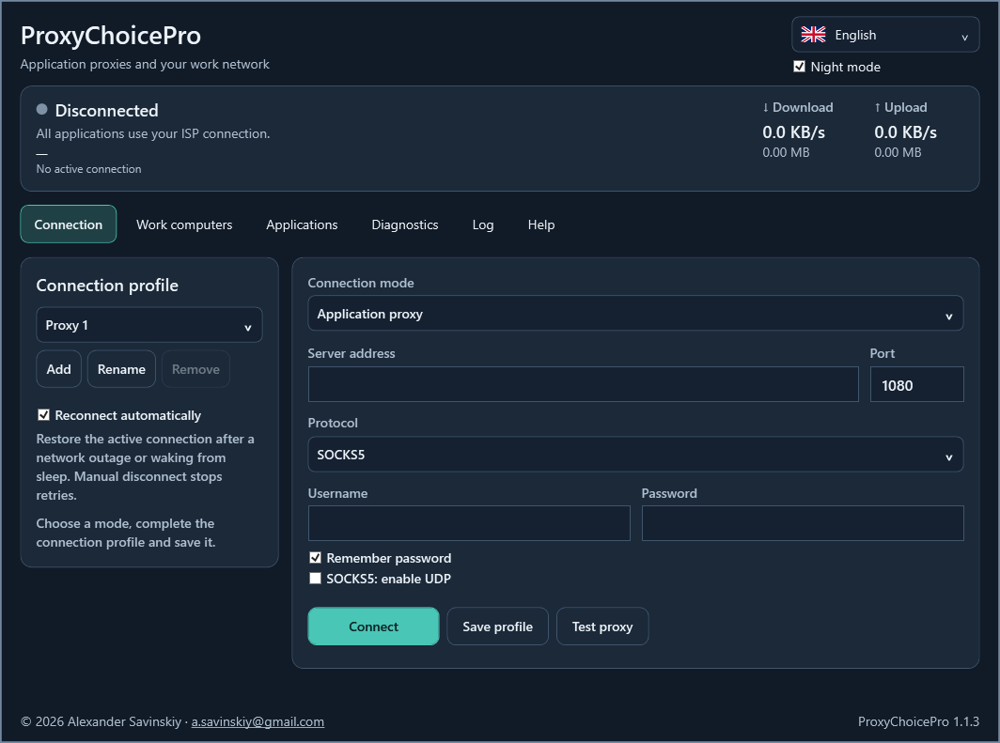

# ProxyChoicePro 1.1.3

Windows 10/11 x64 application for selected-app proxies and work network access through WireGuard. The interface, installer and documentation support English, Russian, French, German, Spanish and Chinese.

[English](docs/Guide-en.md) · [Русский](docs/Guide-ru.md) · [Français](docs/Guide-fr.md) · [Deutsch](docs/Guide-de.md) · [Español](docs/Guide-es.md) · [中文](docs/Guide-zh.md)



## Download and connect

Download from [Releases](https://github.com/alexander-savinskiy/ProxyChoiceApp/releases): ProxyChoicePro-Setup.exe installs shortcuts and an uninstaller; ProxyChoicePro.exe runs standalone with its bundled runtime. Portable and source ZIP archives and SHA256SUMS.txt are also supplied.

**Public package privacy:** a clean installation has no configured proxy, WireGuard client, VPN keys or work computer. The [import template](docs/work-client.example.conf) contains only `REPLACE_WITH_...` placeholders. Complete it with settings issued for your own client; an unfinished template is rejected. Enter and save your real settings locally. Published screenshots show an empty profile. Documentation/test addresses use reserved example networks, and the release build audits source and archive contents before publishing.

For work access select **Work network**, import a WireGuard **client** .conf issued for this laptop, and click **Connect**. Add a work PC IP under **Computers** and open normal Windows Remote Desktop. A reachable TCP probe verifies work access. See the [Keenetic guide](docs/Keenetic-en.md) for router-side client registration. Knowing the router's public IP alone does not establish VPN access.

Work mode routes only the configured work networks. It supports IPv4, IPv6 and optional preshared keys. Other Internet traffic retains ordinary routing. Imported DNS settings are not installed; work PC favorites use IP addresses. Profiles with 0.0.0.0/0 or ::/0 require explicit work routes. Scripts, multiple peers and default work routes are rejected. Overlapping home/work subnets are reported; individual PC /32 routes can reduce the conflict, but the same IP cannot identify two different destinations.

**Proxy mode** retains SOCKS5, HTTP and HTTPS with per-application choices, optional SOCKS5 UDP, Microsoft Store rules, shared application selections and proxy profiles. The app's Internet probes use the selected proxy. Other apps remain direct and private LAN addresses remain direct in this mode. DNS uses proxy DoH and FakeIP with direct resolution for direct connections. Browser PWAs share the browser's executable. Store rules can cover shared Microsoft login/update endpoints; third-party downloaders may need separate selection.

The application list includes Chrome, Edge, installed browsers, ChatGPT, Codex and codex-computer-use-swift. Codex groups its detected desktop, CLI and code-mode executables. Selections sharing an executable stay linked. Missing apps remain visible as unavailable; Microsoft Store has a separate selection. Prepared WireGuard files can carry validated ProxyChoicePro route/probe comments; see section 13 of the guides.

## Interface and recovery

Six wrapping tabs separate connection, computers, applications, diagnostics, journal and help. The connection form stacks on narrow windows. Night mode and language are saved, and the window has a visible outline. Status colors apply to the entire icon: grey disconnected, amber connecting, green verified, red access error; there is no separate taskbar status overlay.

Diagnostics distinguishes engine startup, actual work TCP access, a chosen RDP service and subnet overlaps. A successful TCP connection is not a Windows credential test. Automatic recovery retries after 5, 10, 20, 40 and then 60 seconds on connection failure or resume. Manual disconnect, stop reconnecting and exit cancel retries. This is not a persistent kill switch: stopping the engine restores ordinary Windows routing.

Traffic totals cover the current engine session; displayed MB use 1,048,576 bytes. RDP files enable NLA/CredSSP and ask Windows for credentials; the application does not save RDP passwords.

## Data and lifecycle

Profiles, keys, proxy credentials and favorites are protected by Windows DPAPI under `%LOCALAPPDATA%\ProxyChoicePro`. First launch migrates the prior ProxyChoiceApp encrypted profile store while retaining the original. The engine's private plaintext configuration is removed after startup. Owned child processes use Windows Job Objects, bounded startup/check/shutdown and forced termination as needed. Closing the app stops its engine and removes session files. Journal exports redact known proxy credentials and WireGuard private/preshared keys.

Administrator permission is required for Windows TUN routing. Diagnostics can test WireGuard in userspace without installing Windows routes. Avoid simultaneous TUN applications during routing tests. Windows RDP hosting must be enabled on a supported work PC edition, with suitable Windows firewall access.

## Build and verify

Use Windows x64 and .NET SDK 10.0.401:

```powershell
.\scripts\Build.ps1 -Dotnet (Get-Command dotnet).Source -OutputDirectory dist/release
```

The build verifies pinned sing-box 1.14.3 and its corresponding upstream source, targets .NET runtime 10.0.12, runs the real local engine tests, creates the standalone executable, compiles a six-language installer and packages source and licenses. Tests cover authenticated proxies, real encrypted WireGuard peers, work routes, RDP document validation, subnet conflicts, credential storage and process lifecycle. They do not change Windows routes. Run native routing tests as the ordinary Windows user; a restricted sandbox can deny process-table access.

GitHub Actions builds the same assets and verifies installer extraction. A version-matching v* tag publishes the release. Do not put personal profiles, keys, runtime caches or logs into source control. Internal source folders and namespaces retain ProxyChoiceApp for resource and test compatibility; user-visible branding and executable names are ProxyChoicePro.

## License

© 2026 Alexander Savinskiy · [a.savinskiy@gmail.com](mailto:a.savinskiy@gmail.com). GPL-3.0-or-later; see LICENSE.txt and THIRD-PARTY-NOTICES.txt. The unmodified sing-box engine and its exact corresponding source are included. The application is independent of SagerNet and Keenetic.
