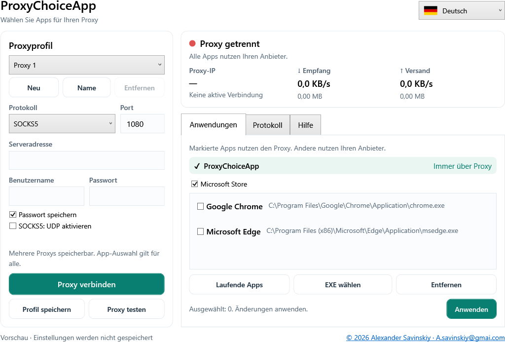

# ProxyChoiceApp — Deutsch

Autor: **Alexander Savinskiy** · [A.savinskiy@gmai.com](mailto:A.savinskiy@gmai.com)
Windows 10/11 x64 · GPL-3.0-or-later

[Benutzerhandbuch](Guide-de.md) · [English](../README.md) · [Русский](README-ru.md) · [Español](README-es.md)



## Installation

Unter [Releases](https://github.com/alexander-savinskiy/ProxyChoiceApp/releases) finden Sie **ProxyChoiceApp-Setup.exe** für die Installation mit Verknüpfungen sowie **ProxyChoiceApp.exe** für den Start ohne Installation. .NET ist bereits enthalten.

Protokoll, Server, Port, Benutzername und Passwort eingeben. Apps wählen und verbinden. Windows fordert zum Tunnelstart Administratorrechte an. Proxy testen prüft den Zugriff ohne Routenänderung. Trennen und Beenden stellen die Anbieter-Verbindung wieder her.

## App-Auswahl

Während der Verbindung nutzt ProxyChoiceApp selbst immer den Proxy für Internetzugriff. Microsoft Store ist standardmäßig gewählt und kann deaktiviert werden. Chrome und Edge sind separat wählbar. Gefundenes installiertes YouTube wird beim ersten Start hinzugefügt. Die YouTube-Web-App teilt die Route ihres Browsers.

Nicht markierte Apps nutzen den Internetanbieter. Private LAN-Adressen wie **192.168.8.1** bleiben direkt. Die App-Auswahl gilt für alle gespeicherten Proxyprofile. Nach Anwenden betroffene Apps neu starten.

Die Oberfläche bietet Englisch, Französisch, Spanisch, Chinesisch, Deutsch und Russisch mit Flaggen, ausführliche Hilfe, Geschwindigkeit, Empfangs- und Versandmengen sowie ein löschbares, exportierbares Protokoll. Zähler erfassen die gesamte vom Kern verarbeitete Tunnelsitzung, einschließlich direkter Verbindungen.

## Erstellen

Unter Windows mit .NET SDK **10.0.401**:

```powershell
.\scripts\Build.ps1 -Dotnet (Get-Command dotnet).Source -OutputDirectory dist/release
```

Das Skript prüft SHA-256 des sing-box 1.14.3, testet lokale Prozessrouten und Beendigung und erstellt EXE, Installer und vollständiges Quellpaket. Tests aktivieren keinen globalen TUN. source.zip enthält Quellcode des Kerns und Lizenzen. GitHub Actions führt denselben Build aus; ein `v*`-Tag veröffentlicht eine Version.

Windows DPAPI verschlüsselt Passwörter für den aktuellen Benutzer. Bei App- oder Kernende kehrt Windows zum Anbieter zurück; es gibt keine dauerhafte Netzsperre. Details zu Store, DNS und UDP stehen im [Handbuch](Guide-de.md). Codekommentare sind auf Englisch.
