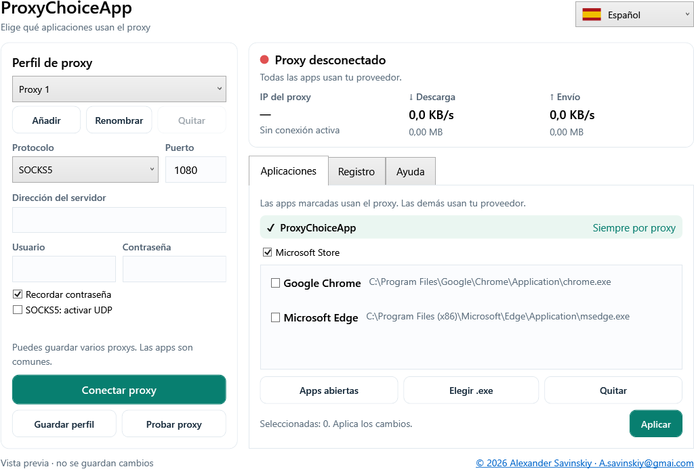

# ProxyChoiceApp — Español

Autor: **Alexander Savinskiy** · [A.savinskiy@gmai.com](mailto:A.savinskiy@gmai.com)
Windows 10/11 x64 · GPL-3.0-or-later

[Guía de usuario](Guide-es.md) · [English](../README.md) · [Русский](README-ru.md) · [Deutsch](README-de.md)



## Instalar y usar

En [Releases](https://github.com/alexander-savinskiy/ProxyChoiceApp/releases), **ProxyChoiceApp-Setup.exe** instala la app y accesos directos. **ProxyChoiceApp.exe** funciona sin instalación. .NET viene incluido.

Introduce protocolo, servidor, puerto, usuario y contraseña. Elige apps y conecta. Windows solicita permisos de administrador para activar el túnel. Probar proxy comprueba el acceso sin cambiar rutas. Desconectar y salir restauran la conexión del proveedor.

## Selección de aplicaciones

Mientras está conectado, ProxyChoiceApp usa siempre el proxy para su propio acceso a Internet. Microsoft Store está marcado por defecto y se puede desactivar. Chrome y Edge se eligen por separado. YouTube instalado se añade en el primer inicio si se detecta. La app web de YouTube comparte la ruta de su navegador.

Las apps sin marcar usan el proveedor. Las direcciones LAN privadas, como **192.168.8.1**, siguen directas. La selección es común a todos los perfiles guardados. Reinicia las apps afectadas después de Aplicar.

La interfaz ofrece inglés, francés, español, chino, alemán y ruso con banderas, ayuda detallada, velocidad, recepción y envío, y registro que se puede limpiar y exportar. Los contadores incluyen toda la sesión de túnel procesada por el motor, también conexiones directas.

## Compilar

En Windows con .NET SDK **10.0.401**:

```powershell
.\scripts\Build.ps1 -Dotnet (Get-Command dotnet).Source -OutputDirectory dist/release
```

El script verifica SHA-256 de sing-box 1.14.3, prueba rutas locales por proceso y cierre, y genera EXE, instalador y fuentes completas. Las pruebas no activan un TUN global. source.zip incluye fuentes del motor y licencias. GitHub Actions hace la misma compilación; una etiqueta `v*` publica una versión.

Las contraseñas se cifran con Windows DPAPI para el usuario actual. Al cerrar la app o el motor, Windows vuelve al proveedor; no hay bloqueo permanente de red. Consulta los detalles de Store, DNS y UDP en la [guía](Guide-es.md). Los comentarios del código están en inglés.
