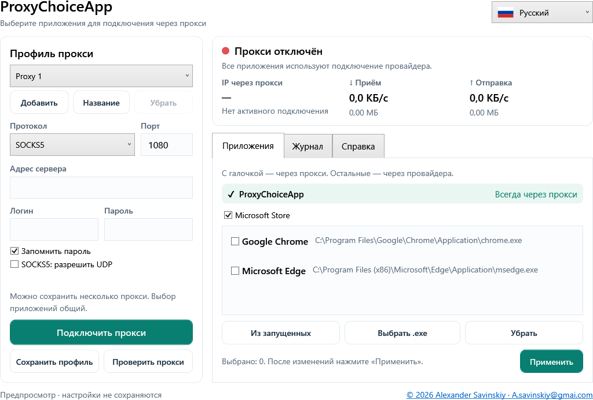

# ProxyChoiceApp — Русский

Автор: **Alexander Savinskiy** · [A.savinskiy@gmai.com](mailto:A.savinskiy@gmai.com)
Windows 10/11 x64 · GPL-3.0-or-later

[Подробное руководство](Guide-ru.md) · [English](../README.md) · [Deutsch](README-de.md) · [Español](README-es.md)



## Установка и запуск

Файлы доступны в [Releases](https://github.com/alexander-savinskiy/ProxyChoiceApp/releases). **ProxyChoiceApp-Setup.exe** устанавливает приложение и ярлыки. **ProxyChoiceApp.exe** запускается без установки. Отдельный .NET не требуется.

Введите тип прокси, адрес, порт, логин и пароль. Выберите приложения и подключитесь. Для включения туннеля Windows запросит права администратора. «Проверить прокси» проверяет доступ без изменения маршрутов. «Отключить прокси» и выход возвращают подключение провайдера.

## Выбор приложений

При подключении ProxyChoiceApp всегда использует прокси для своего интернет-трафика. Microsoft Store включён по умолчанию, его можно убрать. Chrome и Edge выбираются отдельно. Найденное установленное приложение YouTube добавляется при первом запуске; браузерная версия использует общий маршрут своего браузера.

Приложения без галочки идут через провайдера. Локальная сеть, включая модем **192.168.8.1**, остаётся прямой. Выбор общий для всех сохранённых профилей прокси. После «Применить» перезапустите затронутые программы.

В интерфейсе шесть языков с флажками: русский, английский, немецкий, испанский, французский и китайский. Есть подробная справка, скорость, объём приёма и отправки, очистка и экспорт журнала. Счётчики показывают весь трафик сеанса туннеля, обработанный движком, включая прямой.

## Сборка

На Windows установите .NET SDK **10.0.401** и выполните:

```powershell
.\scripts\Build.ps1 -Dotnet (Get-Command dotnet).Source -OutputDirectory dist/release
```

Скрипт проверяет SHA-256 sing-box 1.14.3, запускает локальные проверки маршрутизации и завершения процессов, собирает EXE, установщик и архив исходников. Тесты не включают глобальный TUN. Исходники движка и лицензии входят в source.zip. GitHub Actions выполняет такую же сборку; тег `v*` создаёт релиз.

Пароли сохраняются шифрованными Windows DPAPI для текущего пользователя. После закрытия или остановки движка Windows возвращается к провайдеру; постоянной блокировки сети нет. Особенности Store, DNS и UDP описаны в [руководстве](Guide-ru.md). Комментарии в коде — на английском.
